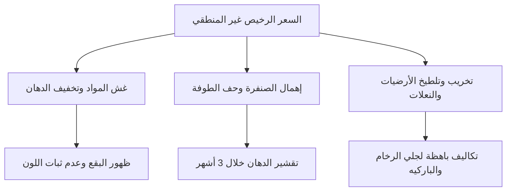

# كم تكلفة صبغ الغرفة والشقة في الكويت؟ (دليل أسعار الصباغين وحساب التكلفة لعام 2026)

**يبدأ سعر صبغ الغرفة الواحدة في الكويت عادةً من 20 إلى 30 ديناراً كويتياً للتشطيب العادي أو التجديد السريع، بينما يتراوح بين 35 إلى 50 ديناراً كويتياً للغرفة القياسية (4×4 أو 4×5 متر) عند استخدام أصباغ أصلية ممتازة مثل جوتن فينوماستيك شاملة المعجون وتجهيز الحوائط وحماية الأرضيات. أما صبغ شقة كاملة مكونة من 3 غرف وصالة فيتراوح إجمالاً بين 160 إلى 280 ديناراً كويتياً حسب حالة الجدران ونوع الدهان.**

---

عندما يقرر صاحب منزل أو مستأجر في الكويت تجديد طوفة بيته، فإن أول سؤال يتبادر إلى ذهنه هو: *كم سيكلفني هذا العمل بالضبط؟* ولماذا يعرض صباغ تنفيذ الغرفة بـ 15 ديناراً، بينما يطلب فني آخر 45 ديناراً لنفس الغرفة ونفس المساحة؟

إن التفاوت الكبير في أسعار خدمات الصباغة والدهانات داخل محافظات الكويت (سواء في حولي، الفروانية، العاصمة، مبارك الكبير، الأحمدي، أو الجهراء) لا يعود إلى عشوائية السوق فحسب، بل يرتبط ارتباطاً وثيقاً بنوع المواد المستخدمة، ومستوى تأسيس الجدار بالمعجون والسنفرة، وما إذا كان الاتفاق يقتصر على أجور اليد العاملة فقط أم يشمل التوريد والتنفيذ الكامل مع حماية الأثاث والأرضيات.

في هذا الدليل التفصيلي الشامل، نضع بين يديك كل ما تحتاج لمعرفته حول **سعر صبغ الغرفة بالكويت**، وطرق تسعير الشقق والفلل، والتكاليف الحقيقية للمواد في منافذ بيع الشويخ، بالإضافة إلى مثال حسابي عملي لشقة كاملة، ونصائح ذهبية لتجنب فخاخ الصباغين التجاريين.

---

## جدول متوسط أسعار صبغ الغرف والشقق في الكويت لعام 2026

لمساعدتك على وضع ميزانية تقريبية دقيقة قبل الاتصال بالصباغ أو طلب المعاينة، يوضح الجدول التالي النطاقات السعرية المعتمدة ميدانياً في السوق الكويتي بالدينار الكويتي (KWD):

| نوع المساحة / الوحدة | المساحة التقديرية | سعر المصنعية فقط (العمالة بدون مواد) | السعر الشامل للمواد الأصلية (جوتن / كابارول) | مدة التنفيذ المتوقعة |
|---|---|---|---|---|
| **غرفة مفردة عادية** | 4×4 م أو 4×5 م | 12 - 18 د.ك | 25 - 45 د.ك | يوم واحد |
| **غرفة ماستر مع غرفة تبديل** | 5×6 م فأكثر | 20 - 28 د.ك | 40 - 65 د.ك | 1 - 2 يوم |
| **صالة استقبال / مجلس ضيوف** | 6×8 م إلى 7×10 م | 25 - 45 د.ك | 55 - 85 د.ك | 2 يوم |
| **شقة استوديو (غرفة وصالة وممر)** | 50 - 65 م² | 45 - 70 د.ك | 80 - 140 د.ك | 2 - 3 أيام |
| **شقة متوسطة (غرفتين وصالة وممر)** | 75 - 95 م² | 70 - 110 د.ك | 130 - 210 د.ك | 3 - 4 أيام |
| **شقة عائلية (3 غرف وصالة وممر)** | 110 - 140 م² | 90 - 140 د.ك | 160 - 280 د.ك | 3 - 5 أيام |
| **دور فيلا كامل (4 غرف وصالتين وممرات)**| 200 - 300 م² | 160 - 240 د.ك | 320 - 480 د.ك | 5 - 7 أيام |

> **تنويه ميداني مهم:** هذه الأسعار استرشادية مبنية على مسح لأسعار الفنيين والشركات المعتمدة في الكويت. تتغير التكلفة النهائية بناءً على المعاينة الميدانية، ووجود رطوبة أو شروخ عميقة، ونوع الصبغ المختار، وارتفاع الأسقف.

---

## كيف تُحسب تكلفة صبغ الغرفة؟ أين تذهب أموالك بالضبط؟

حين تدفع مبلغ 35 ديناراً لصبغ غرفة نومك، فإن هذا المبلغ لا يذهب فقط كأجر يد للفني، بل يتوزع على ثلاثة بنود رئيسية:

### 1. تكلفة المواد الأساسية (الدهان والبرايمر والمعجون)
* **سطل أو جالون الدهان:** دهانات مثل جوتن فينوماستيك (Jotun Fenomastic) يبلغ سعر الجالون سعة 4 لتر منها ما بين 5.5 إلى 8 دنانير كويتية، في حين يبلغ سعر الدرام الكبير (18 لتراً) ما بين 26 إلى 32 ديناراً كويتياً حسب درجة اللمعان والقاعدة اللونية. الغرفة القياسية تحتاج عادةً من 6 إلى 8 لترات دهان لوجهين كاملين.
* **المعجون والأساس:** سحب وجهين معجون ناعم (سافيتو أو كابارول) يتطلب كيس معجون أو علبة جاهزة بتكلفة تتراوح بين 3 إلى 5 دنانير، مع برايمر مائي لتقوية التصاق الدهان بسعر 2 إلى 4 دنانير.
* لمعرفة تفاصيل دقيقة حول عبوات الصبغ وأسعارها بالدينار، يمكنك مراجعة دليلنا المخصص حول [أسعار دهانات جوتن في الكويت بالتفصيل](/blog/jotun-paint-prices-kuwait).

### 2. مستلزمات الحماية والنظافة (التي يتجاهلها الصباغ الرخيص)
* **رولات النايلون السميك:** لتغطية كامل مساحة السيراميك، الرخام، أو الباركيه.
* **الشريط اللاصق الورقي (Masking Tape):** لعزل وتحديد حواف النعلات (Skirting)، مفاتيح الكهرباء، ومقابس الإضاءة، وإطارات الأبواب.
* **أكياس جمع المخلفات والصنفرة:** التأسيس السليم يتطلب صنفرة الجدار بماكينة شفط الغبار أو ورق صنفرة متدرج.
* هذه المستلزمات تستهلك من دينارين إلى 5 دنانير لكل غرفة، ولكنها توفر على صاحب البيت مئات الدنانير التي قد يدفعها لاحقاً لشركات جلي الرخام وتنظيف بقع الدهان المتساقطة.

### 3. أجور اليد العاملة والخبرة الحرفية
تتطلب الغرفة الواحدة ما بين 6 إلى 10 ساعات عمل موزعة على مراحل: تفريغ الأثاث، معالجة الثقوب والشقوق، سحب المعجون وتركه ليجف، الصنفرة، دهان وجه الأساس، ثم تطبيق الوجه الأول والوجه الثاني النهائي مع التشطيب النظيف.

---

## أنظمة المحاسبة المعتمدة في الكويت: اليومية أم بالمقطوع أم بالمتر المربع؟

عند الاتفاق مع الصباغ، ستجد ثلاثة أنظمة تسعير رئيسية متداولة بين أهل الكويت:

```
أنظمة التسعير في سوق الصبغ الكويتي:
├── 1. نظام المقطوعية بالغرفة (Lump-Sum Per Room) -> الأفضل والأنسب للبيوت المسكونة والشقق
├── 2. نظام المتر المربع (Per Square Meter) -> الأنسب للفلل الجديدة والمشاريع الكبيرة
└── 3. نظام اليومية (Daily Labor Wage) -> اقتصادي للصيانات السريعة لكنه يحمل مخاطرة المماطلة
```

### أولاً: نظام المقطوعية بالغرفة (الاتفاق الشامل)
* **طريقة الحساب:** يتم الاتفاق على مبلغ محدد للغرفة (مثلاً: 30 ديناراً شامل المواد أو 15 ديناراً مصنعية فقط).
* **المزايا:** الشفافية الكاملة؛ فالعميل يعرف مسبقاً المبلغ الإجمالي المطلوب منه بصرف النظر عما إذا استغرق الصباغ 6 ساعات أو يومين لإتمام الغرفة.
* **نصيحتنا:** هذا هو النظام الأنسب والأكثر أماناً بنسبة 90% من الحالات لتجديد صبغ الشقق والمنازل المأهولة.

### ثانياً: نظام المتر المربع (للمشاريع والمساحات المفتوحة)
* **طريقة الحساب:** يقاس مسطح الجدران بعد خصم مساحات الأبواب والنوافذ (الدرايش). يتراوح سعر صبغ المتر المربع الداخلي في الكويت عادةً بين **750 فلساً إلى 1.500 دينار كويتي** للمصنعية والمواد حسب عدد أوجه المعجون.
* **المزايا:** عادل جداً في المساحات الشاسعة مثل الصالات المفتوحة الكبيرة، المجمعات التجارية، أو الفلل في مرحلة التشطيب الكامل.

### ثالثاً: نظام يومية الصباغ (Daily Wage)
* **طريقة الحساب:** يتقاضى الصباغ المحترف في الكويت أجراً يومياً يتراوح بين **12 إلى 18 ديناراً كويتياً** عن يوم العمل (من 8 إلى 9 ساعات عمل فعلية)، ويقوم العميل بشراء وتوفير كافة المواد والمستلزمات بنفسه.
* **المحاذير:** هذا النظام ممتاز إذا كان لديك رتوش خفيفة أو تصليحات بسيطة في عدة أماكن متفرقة من البيت. ولكن إذا كانت المساحة كبيرة، فقد يتعمد بعض العمال بطء الحركة لإطالة عدد أيام العمل وزيادة فاتورة اليوميات.
* للمزيد حول كيفية تقييم الفني وشروط العقد، راجع مقالنا حول [كيف تختار صباغ شاطر ورخيص في الكويت](/blog/choose-skilled-affordable-painter-kuwait).

---

## 5 عوامل تتحكم في رفع أو خفض فاتورة صبغ بيتك

إذا تلقيت عرض سعر يبدو مرتفعاً، تحقق من هذه العوامل الخمسة، فهي التي تحدد التكلفة الحقيقية لأي مشروع صباغة:

### 1. حالة الجدران ووجود عيوب سابقة
إذا كانت الجدران سليمة وبحاجة فقط إلى "تجديد لون"، فلن تحتاج سوى وجه معجون تلقيط خفيف ثم وجهين صبغ. أما إذا كانت الطوفة تعاني من:
* تقشير في طبقات الصبغ القديمة.
* شروخ شعرية أو فواصل هبوط بين الطابوق والخرسانة.
* آثار رطوبة أو نش ناتج عن بايبات تكييف سابقة.
فإن الصباغ سيضطر لكشط الجدار بالكامل حتى الوصول للمساح الأساسي، ومعالجة العازل المائي، وسحب 3 أوجه معجون شبك، مما يرفع تكلفة الغرفة بمقدار 10 إلى 20 ديناراً إضافية. إذا كانت جدرانك تعاني من هذه المشكلة، فاحرص على الاطلاع على تفاصيل [تكلفة معالجة رطوبة الجدران قبل الصبغ](/blog/damp-wall-treatment-cost-kuwait) لضمان عدم إهدار أموالك في صبغ يتقشر بعد أسابيع.

### 2. التغيير الجذري بين درجات الألوان (Dark to Light)
إذا كانت غرفتك مدهونة حالياً بلون بني داكن، كحلي، أو رمادي فحمي، وترغب في تحويلها إلى ألوان البيج والأوف وايت الهادئة المودرن، فلن يكفي تطبيق وجهين دهان عاديين؛ فاللون الغامق سيظل ينزف من أسفل الطبقة الجديدة.
هذا التحول يتطلب طبقة أساس بيضاء عالية التغطية (Primer / Undercoat) يليها وجهان إلى 3 أوجه من اللون الجديد، مما يستهلك مواد إضافية ويرفع التكلفة بنسبة 20-30%.

### 3. درجة لمعان الصبغ (مطفي، ربع لمعة، نص لمعة)
* **الصبغ المطفي (Matt):** يخفي عيوب تعريج الجدران وسعره في المتناول، لكنه أصعب في الغسيل المتكرر، ويستخدم غالباً للأسقف والمجالس الرسمية.
* **صبغ ربع اللمعة (Silk / Quarter Sheen):** هو الخيار الأكثر شعبية وطلباً في بيوت الكويت؛ فهو يجمع بين الملمس المخملي الفخم وسهولة المسح بالماء والصابون، وهو أغلى من المطفي بحوالي 15-20% على مستوى المواد.
* يمكنك قراءة مقارنة هندسية تفصيلية بين هذه الأنواع عبر دليلنا: [الفرق بين الصبغ المطفي والربع لمعة في الصالات وغرف النوم](/blog/matte-vs-eggshell-paint-kuwait).

### 4. الأسقف والكرانيش والجبس بورد
هل يشمل الاتفاق صبغ سقف الغرفة؟ الأسقف الجبسية ذات الإضاءات المخفية (Cove Lighting) والسبوت لايت تتطلب وقتاً وحرفية أعلى بكثير من الجدران المستوية المستقيمة. صبغ السقف مع معالجة فواصل ألواح الجبس يضيف عادةً ما بين 8 إلى 15 ديناراً لكل غرفة.

### 5. إخلاء وحماية الأثاث
صبغ شقة فارغة تماماً أسرع وأرخص بمعدل 25% من صبغ شقة مفروشة بالكامل يعيش سكانها داخلها؛ حيث يضيع نصف وقت اليوم الأول في تجميع الأثاث في منتصف الصالة وتغليفه بالنايلون لحمايته من الرذاذ والبودرة.

---

## مثال تطبيقي عملي: ميزانية صبغ شقة 3 غرف وصالة في الكويت

لكي تتضح لك الصورة بالأرقام الحقيقية، دعنا نحسب التكلفة التقديرية لشقة نموذجية شائعة في مناطق مثل السالمية، حولي، صباح السالم، أو الفروانية:

### مواصفات الشقة:
* صالة معيشة (6×4 م).
* 3 غرف نوم (منها غرفة ماستر 5×4 م وغرفتين 4×4 م).
* ممر موزع وحمامين (الأسقف فقط).
* الجدران بحالة متوسطة (تحتاج معجون تلقيط وتغطية ثقوب البراغي القديمة).
* نوع الدهان المطلوب: **جوتن فينوماستيك ربع لمعة (لون Bare أو Breeze)** للغرف والصالة، ومطفي أبيض للأسقف.

### تفصيل المواد المطلوبة وتكلفتها التقديرية:
1. **الدهان النهائي الداخلي:** 2 بستيل/درام كبير (18 لتر) جوتن فينوماستيك = تقريباً 56 إلى 62 د.ك.
2. **صبغ الأسقف (مطفي أبيض):** 1 درام جوتن عادي أو ناشيونال = تقريباً 16 إلى 20 د.ك.
3. **المعجون والأساس والبرايمر:** 2 جالون برايمر مائي + 2 علبة معجون جاهز = 14 إلى 18 د.ك.
4. **مستلزمات الحماية والتغطية:** 4 رولات نايلون سميك + 6 حبات شريط لاصق عريض + صنفرة = 10 إلى 12 د.ك.
* **إجمالي تكلفة المواد الأصلية:** **96 إلى 112 دينار كويتي**.

### أجور المصنعية واليد العاملة:
* فريق مكون من فنيين اثنين لمدة 4 أيام عمل كاملة = **90 إلى 130 دينار كويتي**.
* **التكلفة الإجمالية للشقة كاملة (مواد ومصنعية ونظافة):** **190 إلى 240 دينار كويتي تقريباً**.

بهذه الحسبة الشفافة، إذا عرض عليك صباغ تنفيذ هذه الشقة كاملة مع المواد بسعر 100 دينار فقط، فاعلم يقيناً أنه إما سيستخدم أصباغاً تجارية مقلدة، أو لن يستخدم معجوناً، أو سيخفف البوية بالماء بنسبة 50% لتقليل استهلاك السطول، وهو ما يقودنا إلى النقطة التالية.

---

## 3 فخاخ يقع فيها أصحاب المنازل عند البحث عن صباغ رخيص

البحث عن سعر اقتصادي أمر مشروع، ولكن الوقوع في فخ العمالة السائبة غير المؤهلة يكلفك أضعاف ما وفرته:



1. **فخ تخفيف الدهان المفرط بالماء:** سطل الدهان الأصلي مصمم ليتم تخفيفه بنسبة 10% إلى 15% كحد أقصى من الماء النظيف في الوجه الأول، و5% إلى 10% في الوجه الثاني. بعض الصباغين يقومون بإضافة 40-50% ماء لتوزيع سطل واحد على شقة كاملة! النتيجة: لون باهت، تغطية ضعيفة، وظهور عيوب الحائط بمجرد تسليط إضاءة السبوت لايت.
2. **إهمال الصنفرة والتنظيف قبل الصبغ:** يقوم الصباغ بدهان الطوفة مباشرة فوق الأتربة وبصمات الأيدي والدهون القديمة دون حفها بصنفرة ناعمة ومسحها. بعد مرور شهرين، يبدأ الدهان الجديد بالانسلاخ كقشرة الموز لأنه لم يلتصق بالأساس الإسمنتي.
3. **تلطيخ الرخام ومفاتيح الكهرباء:** الصباغ المتمرس يمضي أول ساعتين في الموقع وهو يغلف الأرضيات والنعلات والأبواب بدقة. أما العامل غير المحترف فيبدأ بالرول فوراً، لتتفاجأ في نهاية اليوم بآلاف النقاط البيضاء على نعلات الخشب ورخام الصالة، مما يتطلب تنظيفها بـ "التنر" الذي قد يزيل لمعان الرخام الطبيعي ويتلفه نهائياً.

---

## أسئلة شائعة يطرحها أهل الكويت حول أسعار الصبغ

### هل الأفضل أن أشتري مواد الصبغ بنفسي من الشويخ أم أتركها للصباغ؟
إذا كنت تملك الوقت والسيارة المناسبة لنقل السطول الثقيلة، فإن شراء المواد بنفسك من الوكلاء المعتمدين ومحلات مواد البناء في الشويخ أو الفحيحيل يضمن لك 100% الحصول على درجات ألوان طازجة غير منتهية الصلاحية وبالأكواد الدقيقة التي اخترتها. أما إذا اتفقت مع صباغ ثقة أو شركة معتمدة، فاشترط أن يحضر عبوات الدهان مغلقة تماماً ويقوم بفتحها وقراءة باركود الألوان أمام عينيك داخل الشقة قبل البدء.

### كم يستغرق صبغ الغرفة الواحدة؟
تستغرق الغرفة العادية من 6 إلى 8 ساعات، ويمكن إنهاؤها بالكامل خلال يوم واحد إذا كان الجدار جافاً ولا يحتاج معالجات عميقة، بينما تتطلب الشقة الكاملة من 3 إلى 5 أيام عمل متتالية لإتاحة الوقت الكافي لجفاف طبقات المعجون بين كل وجه وآخر.

### هل يشمل سعر الغرفة صبغ الأبواب والشبابيك؟
لا، الاتفاق العرفي في الكويت على "صبغ الغرفة" يشمل الجدران فقط (والسقف بحسب الاتفاق المسبق). صبغ الأبواب الخشبية له تسعير منفصل يتراوح بين 10 إلى 20 ديناراً للباب الواحد حسب حالته ونوع دهانه (ناري، لاكر، أو زيتي).

---

## كيف تحصل على أفضل قيمة لسعر صبغ بيتك في الكويت؟

إن الاستثمار في صبغ منزلك هو أكثر خطوة تجديد تعيد الحيوية والراحة النفسية لمحيطك بأقل تكلفة مقارنة بالهدم والترميم الإنشائي. للحصول على أفضل معادلة تجمع بين السعر العادل والتشطيب المتقن:
1. اطلب دائماً عرض سعر مكتوب ومفصل يوضح نوع الصبغ وعدد الأوجه وماركة المعجون.
2. تفقد [دليل أصباغ الجدران والأسقف الداخلية](/services-guide) للتعرف على خصائص ومواصفات كل نوع من أنواع الدهانات الموصى بها في بيوت الكويت.
3. وإذا كنت ترغب في توفير عناء البحث والمقارنة وضمان حضور فنيين مفحوصين وموثقين بأسعار تنافسية وضمان عدم التلطيخ، يمكنك الآن [طلب معاينة وعرض سعر لصبغ الغرفة أو الشقة](/request-quote) عبر منصتنا بضغطة زر واحدة.
