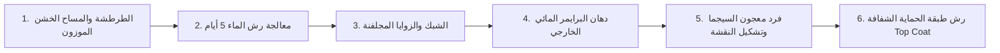

# سعر متر السيجما في الكويت: تكلفة المواد والمصنعية لواجهات الفلل والقسائم 2026

**يتراوح سعر متر السيجما في الكويت بين 4.5 إلى 6 دنانير كويتية للمتر المربع الواحد للاتفاق الشامل، والذي يتضمن توريد معجون السيجما الأصلي (مثل جوتن أو همبل)، وتوريد وتركيب السقالات الحديدية الآمنة، والبرايمر، والشبك، وطبقة الحماية الشفافة العازلة (Top Coat) مع المصنعية. أما إذا كان الاتفاق يقتصر على أجور اليد العاملة والمصنعية فقط بدون مواد، فإن السعر يتراوح بين 2 إلى 3 دنانير كويتية للمتر المربع حسب ارتفاع المبنى وتفاصيل الواجهة.**

---

تعتبر واجهات **السيجما (Sigma Exterior Coating)** الخيار المعماري الأول والأكثر شعبية بلا منازع في مشاريع السكن الخاص بالكويت؛ حيث تغطي واجهات أكثر من 55% من الفلل والقسائم السكنية الحديثة في مناطق مثل المطلاع، غرب عبدالله المبارك، جنوب خيطان، ومدينة صباح الأحمد السكنية.

يرجع هذا الإقبال الكاسح إلى كون السيجما تجمع بين المظهر العصري الفخم (المودرن)، والمرونة العالية في امتصاص التمدد والتقلص الناتج عن الفوارق الحرارية الحادة في صيف الكويت (حيث تلامس درجات حرارة الجدران الخارجية 60° مئوية تحت الشمس المباشرة)، فضلاً عن التكلفة الاقتصادية الممتازة التي توفر على صاحب القسيمة أكثر من 60% إلى 70% من ميزانية تكسية الواجهة بالحجر الطبيعي أو كسر الرخام.

ولكن، كيف يتم حساب سعر المتر بدقة؟ وما هي البنود المخفية التي قد يغفل عنها صاحب البيت في عرض المقاول وتتسبب في مضاعفة الفاتورة أو تشوه الواجهة بعد عامين فقط؟ نجيبك في هذا الدليل الميداني بالتفصيل الهندسي والأرقام الواقعية.

---

## جدول تفصيل تكلفة متر السيجما للواجهات في الكويت لعام 2026

لفهم كيفية تسعير مقاولي الواجهات للمتر المربع، قمنا بتفكيك التكلفة الإجمالية إلى بنودها التأسيسية بالدينار الكويتي (KWD):

| بند التكلفة في المتر المربع | النطاق السعري التقديري بالدينار | النسبة من إجمالي السعر | تفاصيل ومواصفات البند في سوق الكويت |
|---|:---:|:---:|---|
| **توريد وتركيب السقالة الحديدية** | 0.800 - 1.200 د.ك | 18% | سقالات أنبوبية معتمدة مع وسائل الأمان وشبك الحماية الأخضر طوال مدة العمل. |
| **الشبك وزوايا الحواف (Corner Beads)** | 0.350 - 0.500 د.ك | 8% | شبك فايبر غلاس عريض + زوايا مجلفنة أصلية أو ستانلس ستيل مانعة للصدأ. |
| **البرايمر المائي العازل (Exterior Primer)** | 0.400 - 0.600 د.ك | 10% | برايمر أكريليكي مانع للأملاح ومقوٍ للالتصاق ملوّن بنفس درجة السيجما. |
| **عجينة السيجما الملونة (Texture Paste)** | 1.500 - 2.100 د.ك | 35% | براميل سيجما أصلية جاهزة بحبيبات الكوارتز بسماكة 1.5 إلى 2 ملم. |
| **طبقة الحماية النهائية (Top Coat Clear)** | 0.500 - 0.800 د.ك | 12% | دهان أكريليكي شفاف طارد للغبار (Anti-Dust) ومقاوم للأشعة فوق البنفسجية UV. |
| **المصنعية وأجور الفنيين والتشطيب** | 1.500 - 2.000 د.ك | 30% | فرد المعجون بالمالج وتشكيل النقشة المطلوبة بالتساوي وضبط الفواصل. |
| **الإجمالي التقريبي للمتر المربع الشامل** | **4.500 - 6.000 د.ك** | **100%** | **عقد تسليم مفتاح للواجهة الخارجية للمتر المسطح.** |

---

## مقارنة أشهر ماركات السيجما المعتمدة في السوق الكويتي

لا تتساوى خامات السيجما في قدرتها على مواجهة شمس وغبار الكويت؛ لذلك يجب أن ينص عقدك مع مقاول الواجهات بوضوح تام على اسم المادة ومصدرها:

```
أبرز ماركات السيجما في الكويت:
├── جوتن هيريتيج / جوتاشيلد (Jotun Heritage / Jotashield) -> الأعلى ثباتاً للألوان ومقاومة للأشعة فوق البنفسجية
├── همبل تكس / كوتنج (Hempel Paints) -> صلابة ممتازة ومقاومة للمناطق الساحلية والرطوبة
├── كي بي سي الوطنية (KPC Kuwait) -> خامة كويتية عريقة معتمدة في مشاريع الرعاية السكنية
└── السيجما الإيطالية المرنة (Elastomeric Sigma) -> خيار فائق المرونة لسد الشروخ ومقاومة التمدد
```

1. **سيجما جوتن (Jotun):** الخيار الأكثر طلباً وتفضيلاً في قسائم السكن الخاص؛ حيث توفر شركة جوتن تشكيلة ألوان واسعة تحت درجات (Jotun Heritage) المقاومة للأشعة فوق البنفسجية، وتتميز بحبيبات كوارتز منتقاة بدقة لا تبهت مع السنين. لمعرفة أسعار عبوات الدهانات الخارجية لجوتن، راجع مقالنا حول [أسعار أصباغ جوتاشيلد للواجهات الخارجية](/blog/jotun-paint-prices-kuwait).
2. **سيجما همبل (Hempel):** تشتهر منتجات همبل بصلابتها الميكانيكية العالية ومقاومتها الاستثنائية للرطوبة والأملاح، مما يجعلها خياراً مثالياً لقسائم المناطق الساحلية والشاليهات.
3. **سيجما كي بي سي (KPC) والسعودية:** تعتبر خيارات اقتصادية ممتازة ومطابقة للمواصفات القياسية الكويتية، وتستخدم بكثرة في العمارات الاستثمارية والمباني الحكومية بأسعار منافسة تبدأ من 4.2 د.ك للمتر.

---

## مقايسة عملية: كم تكلف واجهة قسيمة 400 متر كاملة في المطلاع أو غرب عبدالله المبارك؟

لكي نضع الأرقام في سياق ميزانية البناء الواقعية، دعنا نجري حسبة تقريبية لقسيمة سكنية نموذجية في الكويت:

### معطيات القسيمة:
* **مساحة الأرض:** 400 م² (أبعاد 20×20 م).
* **عدد الأدوار:** 3 أدوار وسرداب مع بيت الدرج وغرفة المصعد على السطح.
* **ارتفاع المبنى الإجمالي:** حوالي 13 إلى 14 متراً عن منسوب الشارع.
* **إجمالي مسطح الواجهات الخارجية:** حوالي **850 إلى 950 متراً مربعاً**.
* **خصم مساحات النوافذ (الدرايش) والأبواب:** حوالي 15% (نحو 130 م²).
* **المساحة الصافية المطلوب تكسيتها بالسيجما:** **750 متراً مربعاً صافياً**.

### الحسبة المالية الإجمالية:
* عند اختيار **سيجما فاخرة معتمدة (جوتن أو همبل مع طبقة حماية Top Coat وسقالة)** بسعر متوسط **5.0 دنانير كويتية للمتر**:
  $$\text{التكلفة الإجمالية} = 750\text{ م²} \times 5.0\text{ د.ك} = 3,750\text{ دينار كويتي}$$

### مقارنة وفر التكلفة مع الحجر الطبيعي:
* إذا قرر صاحب القسيمة تكسية نفس الواجهة بالحجر الطبيعي الأردني أو الإيراني أو السوري (بسعر وسطي 16 ديناراً للمتر شامل التوريد والتركيب الميكانيكي):
  $$\text{تكلفة الحجر} = 750\text{ م²} \times 16\text{ د.ك} = 12,000\text{ دينار كويتي}$$
* **حجم الوفر المالي المباشر:** **8,250 دينار كويتي!** وهو مبلغ كافٍ لتشطيب أعمال التكييف أو مصعد القسيمة بالكامل.
* وإذا كنت تبحث عن التنسيق الصحيح لخطوات الواجهة بالقسيمة الجديدة، تصفح دليلنا المتخصص حول [دليل تشطيب واجهات قسائم المطلاع بالسيجما والعوازل](/blog/al-mutlaa-villas-exterior-finishing).

---

## فكرة ذكية شائعة في الكويت: "التطعيم المعماري المزدوج"

للحصول على فخامة الحجر واقتصادية السيجما، يتبع مهندسو الديكور في الكويت استراتيجية ذكية جداً تسمى **التطعيم**:
* يتم عمل **80% من مساحة الواجهة سيجما** بألوان البيج الفاتح، الرمادي الدافئ، أو الأوف وايت.
* يتم تطعيم **20% من الواجهة بالحجر الطبيعي، أو شرائح الموزاييك، أو بديل الخشب الخارجي (WPC)** حول المدخل الرئيسي للفيلا وبراويز النوافذ الكبيرة (الدرايش).
* **النتيجة:** واجهة معمارية عصرية فخمة للغاية بتكلفة لا تتجاوز 5,000 إلى 5,500 دينار للفيلا كاملة.

---

## المراحل الست لتطبيق السيجما بطريقة هندسية تمنع التشققات

إن العمر الافتراضي لواجهة السيجما (والذي يتجاوز 10 إلى 15 سنة) يعتمد بنسبة 80% على جودة الخطوات التأسيسية تحت المادة:



1. **الطرطشة الإسمنتية والمساح الخشن (Base Plaster):** لا يجوز نهائياً تطبيق السيجما فوق مساح ناعم أو مساح جيري ضعيف؛ فالسيجما تحتاج مساحاً خشناً بمونة إسمنتية غنية لكي تتغلغل حبيباتها الميكانيكية داخل مسامات الحائط.
2. **المعالجة الكيميائية ورش الماء:** يجب غمر مساح الواجهة بالماء النظيف مرتين يومياً لمدة لا تقل عن 5 إلى 7 أيام متتالية للتأكد من اكتمال التفاعل الكيميائي للإسمنت والتخلص من أي شروخ انكماشية مبكرة.
3. **تركيب شبك الفايبر والزوايا الأصلية:** يتم تثبيت شبك فايبر عريض فوق الفواصل الخرسانية (بين الأعمدة والطابوق) لمنع ظهور الشروخ الإنشائية في السيجما لاحقاً، مع تثبيت زوايا ستانلس ستيل أو زوايا مجلفنة معتمدة عند كافة أركان المبنى والدرايش.
4. **دهان البرايمر الخارجي الملوّن:** دهان طبقة أساس عازلة للرطوبة بنفس درجة لون السيجما المختارة. هذا البند حيوي جداً حتى لا تظهر بقع رمادية أسفل السيجما في حال تباعدت حبيبات المعجون أثناء السحب.
5. **فرد عجينة السيجما بالمالج وتشكيل النقشة:** يقوم الفني المحترف بفرد العجينة بسماكة موحدة (غالباً 2 ملم)، ثم استخدام مالج بلاستيكي بحركات دائرية، طولية، أو عرضية للحصول على النقشة المطلوبة دون ترك فواصل توقف (Joints) ظاهرة في منتصف الواجهة.
6. **طبقة الحماية الشفافة (Top Coat):** بعد جفاف السيجما تماماً (خلال 48 إلى 72 ساعة)، يتم رش طبقة حماية شفافة تعزل الواجهة تماماً ضد مياه الأمطار وتمنع ذرات الغبار الصيفي من الالتصاق بمسامات النقشة. لمقارنة الأنظمة الخارجية الأخرى، تفضل بقراءة [مقارنة شاملة بين السيجما العادية والإيطالية والجرانيت للواجهات](/blog/sigma-types-comparison-kuwait).

---

## 4 فخاخ تعاقدية احذر منها عند الاتفاق مع مقاول السيجما

تحدث أغلب مشاكل الواجهات الخارجية في الكويت بسبب بنود مبهمة يمررها بعض المقاولين:

### 1. استخدام زوايا صاج تجارية رخيصة (فخ الصدأ الكارثي)
تعتبر زوايا النوافذ والأركان أخطر جزء في الواجهة؛ فالزوايا الصينية الرخيصة غير المجلفنة لا تكلف المقاول سوى ربع دينار، ولكنها تصدأ بمجرد تعرضها لرطوبة الشتاء وأملاح الجو، لتظهر خطوط صدأ بنية عمودية مشوهة تنزل على طول الواجهة ويستحيل تنظيفها إلا بتكسير الزاوية بالكامل وإعادة العمل. اشترط دائماً زوايا أصلية إنجليزية مجلفنة أو زوايا PVC مخصصة للواجهات.

### 2. العمل في أوقات الظهيرة الحارقة
في أشهر الصيف الكويتي (من مايو إلى سبتمبر)، تتجاوز حرارة الواجهة المعرضة للشمس 55° مئوية. فرد السيجما في هذا الوقت يؤدي إلى "تبخر الماء الفوري" وجفاف العجينة قبل أن يتمكن الفني من نقشها ومطابقتها، مما ينتج عنه حائط مبقع ومحروق ومليء بالتموجات. يجب أن يلتزم المقاول بالعمل في الصباح الباكر أو بعد العصر، والعمل في الجانب المظلل من القسيمة.

### 3. إلغاء طبقة الـ Top Coat لتقديم سعر منخفض
يقدم لك بعض المقاولين سعراً مغرياً (مثلاً 3.8 د.ك للمتر الشامل) بحجة أنه يقدم "تخفيضاً خاصاً"، بينما هو في الحقيقة يستبعد طبقة الحماية الشفافة (التوب كوت). بدون هذه الطبقة، تتحول واجهتك البيضاء إلى اللون الرمادي المتسخ بعد أول عاصفة غبار (طوز) في الكويت، لأن مسام السيجما الإسفنجية ستمتص الأتربة الناعمة ولا يمكن غسلها بالماء.

### 4. عدم كتابة تفاصيل السقالة ومدة بقائها في العقد
تأكد من أن العقد ينص على أن إيجار السقالة مستمر حتى استلام مهندس الإشراف أو المالك للواجهة وإجراء أعمال الصيانة والتعديل؛ فبعض المقاولين يفرضون غرامات أسبوعية على المالك إذا تأخر الاستلام بحجة انتهاء مدة استئجار السقالات. وإذا كنت ترغب في الاطلاع على أسعار أعمال الصبغ الداخلي والتشطيب العام، يمكنك مراجعة [أسعار الصباغين وأعمال التشطيب في الكويت](/blog/room-painting-cost-kuwait).

---

## أسئلة شائعة حول واجهات السيجما في الكويت

### كم سنة يدوم صبغ السيجما في طقس الكويت؟
عند استخدام مواد أصلية معتمدة (مثل جوتن أو همبل) وتطبيق طبقة حماية عالية الجودة، يدوم مظهر السيجما من **10 إلى 15 سنة** دون تقشير أو بهتان ملحوظ في اللون.

### هل السيجما الخشنة (2 ملم) أفضل أم الناعمة (1 ملم)؟
في بيئة الكويت المعرضة للأتربة والغبار المستمر (السافي)، يوصى بالسيجما ذات الحبيبات المتوسطة إلى الناعمة (1.5 ملم) لأنها تجمع بين المظهر الديكوري الجذاب وسهولة الغسيل وعدم احتجاز الأتربة، مقارنة بالسيجما الخشنة جداً (3 ملم) التي يصعب تنظيف مسامها العميقة.

### هل يمكن غسيل واجهة السيجما بمسدس الماء ذي الضغط العالي؟
نعم، واجهات السيجما المنفذة بشكل صحيح مع طبقة حماية بوليمرية ممتازة تتحمل الغسيل بمسدسات ضغط المياه العادية (Car Washer) لإزالة الغبار المتراكم بعد عواصف الصيف دون أن تتقشر أو تتضرر الحبيبات.

---

## كيف تضمن الحصول على أفضل سعر ومواصفات لواجهتك؟

واجهة بيتك هي بطاقة تعارفك الأولى وأكبر استثمار في الهيكل الخارجي للقسيمة. للحصول على أفضل معادلة تضمن لك الجودة والضمان:
1. اطلب دائماً عينة حقيقية منفذة على لوح تجريبي (Mockup) بمساحة 1×1 م في موقع القسيمة لمطابقة درجة اللون والنقشة تحت ضوء الشمس الطبيعي قبل اعتماد البراميل.
2. اطلع على [خدمات تكسية وتشطيب واجهات السيجما بالكويت](/services-guide) للتعرف على كراسة الشروط والمواصفات المعتمدة.
3. احصل على عرض سعر رسمي ومقايسة مساحات دقيقة لواجهتك من خلال [طلب مقايسة واجهة قسيمة أو فيلا عبر منصتنا](/request-quote) للتواصل مع أفضل مقاولي الواجهات المعتمدين في منطقتك.
