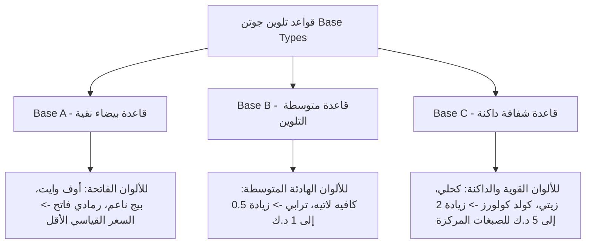

# أسعار دهانات جوتن في الكويت 2026: قائمة أسعار درام وجالون فينوماستيك وجوتاشيلد

**تبدأ أسعار دهانات جوتن في الكويت من 5.5 إلى 8 دنانير كويتية للجالون سعة 4 لتر من سلسلة فينوماستيك الداخلية، وما بين 26 إلى 32 ديناراً كويتياً للدرام أو البستيل الكبير سعة 18 لتراً لمختلف درجات اللمعان (مطفي، ربع لمعة، ونصف لمعة). أما دهانات جوتاشيلد المخصصة للواجهات الخارجية المقاومة للحرارة والشمس الحارقة، فتتراوح أسعار الجالون منها بين 10 إلى 15 ديناراً كويتياً، وتصل أسعار الدرام الكبير (18 لتراً) إلى ما بين 35 إلى 45 ديناراً كويتياً حسب درجة الحماية ونوع القاعدة اللونية.**

---

تحتل دهانات **جوتن (Jotun Paints)** مكانة الصدارة المطلقة في السوق الكويتي لأكثر من أربعة عقود؛ فهي المعيار الذهبي الذي يقيس عليه مهندسو الديكور، ومقاولو التشطيب، وأصحاب الفلل جودة العمل. ويرجع هذا الانتشار إلى قدرة تركيباتها المطورة في مراكز أبحاث الشرق الأوسط على تحمل التحديات البيئية الاستثنائية لمناخ الكويت، وفي مقدمتها أشعة الشمس الصيفية الحارقة، وعواصف الغبار (الطوز)، والرطوبة الساحلية العالية.

لكن عند النزول إلى أسواق ومنافذ بيع مواد البناء في الشويخ الصناعية أو الفحيحيل، يلاحظ الكثير من العملاء تفاوتاً في الأسعار بين محل وآخر، أو بين درجات الألوان المختلفة لنفس العبوة، متسائلين عن السعر العادل والحقيقي لعبوات جوتن الأصلية بمختلف أحجامها.

في هذا الدليل التفصيلي، نستعرض القائمة الكاملة لأسعار دهانات جوتن في الكويت لعام 2026، مع شرح الفروق بين عائلات المنتجات (فينوماستيك، جوتاشيلد، وبرايمرات التأسيس)، وسر اختلاف السعر حسب قاعدة التلوين، بالإضافة إلى خريطة الموزعين المعتمدين وكيفية حساب الكميات بدقة لمنع الهدر المالي.

---

## جدول أسعار دهانات جوتن الداخلية في الكويت (سلسلة فينوماستيك - Fenomastic)

تعد سلسلة **فينوماستيك** أشهر دهان داخلي في بيوت الكويت للجدران والأسقف، وتتوفر في منافذ البيع بعدة تشطيبات ومستويات حماية تلائم مختلف الميزانيات:

| اسم المنتج من جوتن | نوع التشطيب والاستخدام | سعة العبوة | متوسط السعر بالدينار الكويتي (KWD) | أبرز المزايا والمواصفات |
|---|---|:---:|:---:|---|
| **فينوماستيك بيور كولورز مطفي** *(Pure Colours Matt)* | دهان مطفي فاخر للأسقف والمجالس | 4 لتر (جالون)<br>18 لتر (درام) | **5.500 - 6.500 د.ك**<br>**26.000 - 29.000 د.ك** | يخفي عيوب تعريج الجدران، لا يعكس إضاءة السبوت لايت، نعومة فائقة. |
| **فينوماستيك بيور كولورز حريري / ربع لمعة** *(Pure Colours Silk)* | ربع لمعة ناعم لغرف النوم والمعيشة | 4 لتر (جالون)<br>18 لتر (درام) | **6.500 - 8.000 د.ك**<br>**28.000 - 32.000 د.ك** | الأكثر مبيعاً في الكويت؛ قابل للمسح والتنظيف بالماء والصابون بملمس مخملي. |
| **فينوماستيك نصف لماع** *(Semi-Gloss)* | لمعان واضح للممرات والمطابخ التحضيرية | 4 لتر (جالون)<br>18 لتر (درام) | **7.000 - 8.500 د.ك**<br>**29.000 - 33.000 د.ك** | مقاومة فائقة لامتصاص الرطوبة والأبخرة وسهل الغسيل المتكرر. |
| **فينوماستيك وندر وول لايف** *(Wonderwall Life)* | فائق المقاومة للبقع (Ultra Washable) | 4 لتر (جالون)<br>18 لتر (درام) | **9.000 - 14.000 د.ك**<br>**38.000 - 46.000 د.ك** | تقنية فاخرة تمنع امتصاص بقع القهوة والألوان، عديم الرائحة وصديق للبيئة. |

> **ملاحظة حول الأسعار:** هذه الأسعار استرشادية مبنية على فواتير الموزعين المعتمدين في الشويخ. يزداد سعر العبوة قليلاً بمقدار نصف دينار إلى دينارين إذا تم تلوينها بدرجات ألوان مركزة داكنة (مثل الكحلي أو الزيتي أو الرمادي الفحمي) نتيجة تكلفة صبغات ماكينة التلوين.

---

## جدول أسعار دهانات جوتن الخارجية في الكويت (سلسلة جوتاشيلد - Jotashield)

صُممت عائلة **جوتاشيلد** خصيصاً لتحمل شمس الخليج القاسية وحماية واجهات الفلل والقسائم من التشقق والبهتان:

| اسم المنتج الخارجي | نوع الحماية | سعة العبوة | متوسط السعر بالدينار الكويتي (KWD) | الاستخدام الموصى به في الكويت |
|---|---|:---:|:---:|---|
| **جوتاشيلد إكستريم** *(Jotashield Extreme)* | عاكس للأشعة تحت الحمراء وخافض للحرارة | 4 لتر<br>18 لتر | **12.000 - 15.000 د.ك**<br>**38.000 - 45.000 د.ك** | أفضل خيار لواجهات الفلل والقسائم المعرضة للشمس المباشرة لتقليل استهلاك التكييف بنسبة تصل إلى 15%. |
| **جوتاشيلد كولورلاست** *(Jotashield ColourLast)* | ثبات معتمد للألوان ومقاومة للأشعة UV | 4 لتر<br>18 لتر | **10.000 - 13.000 د.ك**<br>**34.000 - 40.000 د.ك** | يحمي الواجهة من البهتان والاصفرار الناتج عن الغبار والشمس لمدة تزيد عن 10 سنوات. |
| **جوتاشيلد تكس / هيريتيج** *(Jotashield Tex / Heritage)* | دهان ملمسي خشن (بديل السيجما الخفيفة) | 18 لتر (درام) | **18.000 - 24.000 د.ك** | يوفر ملمساً حبيبياً راقياً يغطي شروخ المساح الخارجي الدقيقة. |
| **جوتاشيلد كليير / توب كوت** *(Clear Protective Topcoat)* | طبقة حماية شفافة عازلة للغبار | 18 لتر (درام) | **22.000 - 27.000 د.ك** | تُدهن فوق واجهات السيجما والأصباغ الخارجية لمنع التصاق ذرات الغبار (الطوز) وتسهيل غسيل الواجهة. |

إذا كنت تدرس تشطيب واجهة فيلتك بالكامل وتبحث عن مقارنة سعرية بين الدهان والسيجما، ننصحك بالاطلاع على دليلنا الشامل حول [سعر متر السيجما في الكويت ومقايسة واجهة الفيلا](/blog/sigma-exterior-cost-kuwait).

---

## أسعار البرايمر ومواد التأسيس وسحب المعجون من جوتن

التشطيب النهائي الناعم لجدرانك لا يمكن أن يتحقق بدون مواد تأسيس أصلية:

```
مواد التأسيس من جوتن في الكويت:
├── جوتن برايمر مائي (Jotun Water-Based Primer 18L) -> 8.000 إلى 10.500 د.ك (لتقوية التصاق الدهان وسد مسام المساح)
├── برايمر مانع للبقع (Stain-Resistant Primer 4L) -> 5.500 إلى 7.500 د.ك (عازل لآثار نش المكيفات والدهون قبل الصبغ)
└── معجون جوتن التجهيزي الداخلي (Jotun Interior Putty) -> 4.500 إلى 6.500 د.ك للعبوة (لسحب أوجه التنعيم وسد الشقوق)
```

استخدام برايمر مائي من جوتن قبل دهان فينوماستيك يقلل من استهلاك الدهان النهائي المكلف بنسبة 25%؛ فالجدار غير المدهون ببرايمر يمتص الدهان بشراهة كالإسفنج، مما يضطرك لشراء براميل إضافية. وإذا كنت تخطط لصبغ غرف بيتك بالكامل، يمكنك مراجعة [تكلفة صبغ الغرفة مع المواد الأصلية بالتفصيل](/blog/room-painting-cost-kuwait).

---

## سر اختلاف السعر: لماذا يزيد سعر السطل باختلاف درجة اللون؟

يتفاجأ بعض أصحاب المنازل عند شرائهم بستيل جوتن بلون كحلي أو زيتي بأن البائع يطلب 34 ديناراً بدلاً من 28 ديناراً لنفس المنتج المكتوب عليه فينوماستيك. السبب في ذلك يعود إلى نظام **قواعد التلوين (Base Types)** في مكائن تلوين جوتن بالكمبيوتر (Jotun Multicolor System):



* **قاعدة A (Base A):** تحتوي العبوة على نسبة عالية من مادة ثاني أكسيد التيتانيوم الأبيض، وهي مخصصة لإنتاج درجات الألوان الفاتحة الرائجة في بيوت الكويت (مثل: Breeze, Bare, Twilight, Timeless). هذه القاعدة تستهلك كمية صبغة ملونة قليلة جداً، لذا تباع بسعر الكتالوج القياسي الأساسي. لتفقد كود كل لون ودرجته على الطبيعة، راجع [أحدث كتالوج ألوان جوتن لبيوت الكويت لعام 2026](/blog/jotun-paint-colors-kuwait).
* **قاعدة C (Base C):** تكون العبوة شبه شفافة بدون صبغة بيضاء؛ لكي تستقبل كميات كبيرة ومكثفة من الصبغات الكيميائية المركزة لإنتاج الألوان الداكنة جداً. كمية الصبغات الإضافية التي تضخها الماكينة هي التي ترفع سعر السطل بما يعادل 2 إلى 5 دنانير حسب تركيز اللون.

---

## كم علبة صبغ تحتاج لبيتك؟ معادلة حساب الكميات الدقيقة

لكي لا تشتري سطولاً زائدة تبقى مهدرة في المستودع، أو ينقصك الصبغ في منتصف العمل، اعتمد هذه المعادلة الهندسية البسيطة:

### 1. معدل الفرد القياسي لدهان جوتن فينوماستيك
* يغطي لتر الدهان الواحد مساحة **9 إلى 11 متراً مربعاً** للوجه الواحد على الجدران المؤسسة بالبرايمر.
* **الجالون سعة 4 لتر:** يغطي مساحة صافية تبلغ حوالي **20 متراً مربعاً لوجهين كاملين**.
* **الدرام سعة 18 لتر:** يغطي مساحة صافية تبلغ حوالي **90 إلى 100 متر مربع لوجهين كاملين**.

### 2. مثال لحساب غرفة نوم قياسية (4×5 متر)
* محيط الغرفة = $(4 + 5) \times 2 = 18$ متراً طولياً.
* مساحة الجدران (بارتفاع 3 أمتار) = $18 \times 3 = 54$ متراً مربعاً.
* خصم مساحة الباب والنافذة (حوالي 6 م²) = المساحة الصافية **48 متراً مربعاً**.
* **الكمية المطلوبة:** تحتاج الغرفة إلى حوالي **9 إلى 10 لترات دهان** (أي جالونين ونصف، أو بستيل كبير سعة 18 لتر يكفيك لصبغ غرفتين كاملتين لوجهين معجون وتشطيب ناعم).

---

## أين تشتري دهانات جوتن الأصلية في الكويت؟

لضمان الحصول على دهانات أصلية مخزنة في بيئة مكيفة ومطابقة للمواصفات، توجه دائماً للموزعين المعتمدين وتجنب المحلات العشوائية غير المرخصة:

```
أبرز مراكز ومنافذ بيع جوتن المعتمدة في الكويت:
├── الشويخ الصناعية (المركز الرئيسي): شارع كندا دراي، شارع البنوك، ومجمع جواد الصفار
├── الفحيحيل الصناعية: شارع الدبوس ومنطقة المحلات المركزية (خدمة محافظة الأحمدي ومبارك الكبير)
├── الجهراء الحرفية: مجمع الحرفيين وسوق مواد البناء (خدمة قسائم المطلاع والجهراء)
└── أسواق القرين: المحلات المعتمدة لمواد البناء والديكور (خدمة مناطق القرين والعدان والقصور)
```

### علامات التأكد من أصالة سطل جوتن:
1. **شريط الأمان البلاستيكي (Factory Seal):** تأكد من أن الشريط الدائري المحيط بغطاء السطل سليم تماماً ولم يتم قصه أو إعادة كبسه يدوياً.
2. **لاصقة ماكينة التلوين المبرمجة:** يجب أن تجد لاصقة بيضاء مطبوعة بالكمبيوتر تحتوي على: اسم المعرض، تاريخ ووقت التلوين، كود اللون، واسم الموزع المعتمد.
3. **تاريخ الإنتاج:** احرص على ألا يكون تاريخ إنتاج الدهان المدون أسفل العبوة قد مضى عليه أكثر من 18 شهراً لضمان عدم تلف المواد الرابطة أو تكتل السائل. إذا كنت تريد حماية نفسك من أي تلاعب في المواد، ننصحك بقراءة [كيف تكشف غش الصباغين وحيل خلط البوية بالكويت](/blog/painter-deception-detection-kuwait).

---

## أسئلة شائعة حول دهانات جوتن في الكويت

### ما هو الفرق بين فينوماستيك العادي وفينوماستيك بيور كولورز؟
أوقفت جوتن تصنيع الفينوماستيك التجاري القديم واستبدلته بـ **فينوماستيك بيور كولورز (Pure Colours)**، والذي يتميز بأنه خالٍ تماماً تقريباً من المركبات العضوية المتطايرة (Zero VOC)، وعديم الرائحة الكيميائية النفاذة، مع قدرة تغطية أعلى بنسبة 20% تعطي ألواناً مطابقة تماماً لشريحة الكتالوج.

### هل أسعار دهانات جوتن موحدة في جميع معارض الكويت؟
توجد قائمة أسعار إرشادية موصى بها من شركة جوتن للوكلاء، ولكن قد تجد فارقاً بسيطاً يتراوح بين نصف دينار إلى دينار ونصف بين معرض وآخر في الشويخ بناءً على حجم الشراء، أو العروض الموسمية، أو التوصيل المجاني للموقع في القسائم الجديدة.

### هل يمكن دهان سقف الغرفة بدهان فينوماستيك ربع لمعة؟
من الناحية الهندسية يمكن ذلك، ولكنه **غير موصى به إطلاقاً**؛ لأن دهانات ربع اللمعة ونصف اللمعة تعكس إضاءة السبوت لايت والثريات بشكل مزعج وتظهر كافة عيوب وفواصل ألواح الجبس بورد في السقف. المعيار الصحيح دائماً هو استخدام **الدهان المطفي الأبيض النقي (Matt)** للأسقف، واختيار ربع اللمعة للجدران.

---

## خطوتك التالية: تطبيق دهانات جوتن باحترافية تامة

شراء سطل الدهان الأصلي من جوتن يمثل 50% من جودة جدارك، أما الـ 50% المتبقية فتعتمد على مهارة الفني الذي يمسك بالرول والسكين ويعرف متى يصنفر وكيف يوزع المعجون دون ترك أثر للوصلات.
* يمكنك مراجعة [دليل ماركات الأصباغ المعتمدة في الكويت](/services-guide) لاكتشاف المزيد من البدائل والمواصفات الفنية.
* وإذا كنت تريد راحة البال وضمان قيام فنيين محترفين وموثوقين بتنفيذ منزلك بدهانات جوتن الأصلية المختومة مع كفالة على جودة الشغل والنظافة، يسعدنا مساعدتك في [طلب صباغ معتمد لتطبيق دهانات جوتن الأصلية عبر منصتنا](/request-quote) مع معاينة فورية لبيتك.
