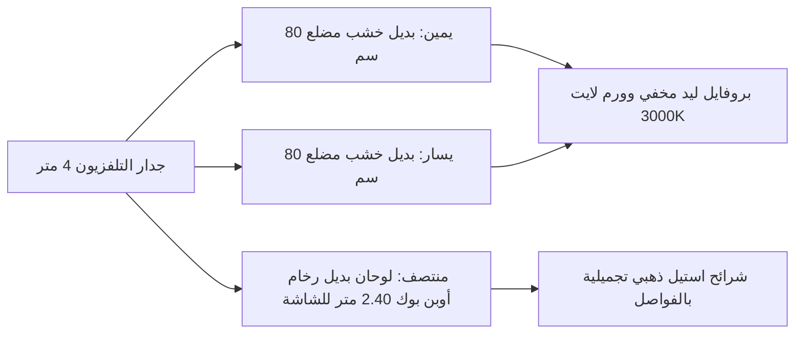

# سعر تركيب بديل الرخام وبديل الخشب في الكويت: تكلفة الألواح والمصنعية 2026

**يتراوح سعر لوح بديل الرخام الخام (مقاس 1.22 × 2.80 متر) في محلات الشويخ بين 6 إلى 12 ديناراً كويتياً، في حين تبلغ تكلفة تركيبه الشامل للمواد والصمغ والقص بين 18 إلى 28 ديناراً كويتياً للوح الواحد. أما بديل الخشب (شرائح WPC المضلعة) فيتراوح سعر القطعة الواحدة منها بين 2.5 إلى 4.5 دنانير كويتية، وتبلغ تكلفة المتر المربع توريد وتركيب مع الإكسسوارات ما بين 12 إلى 22 ديناراً كويتياً حسب التصميم ودمج الإضاءة المخفية.**

---

أحدثت تكسيات **بديل الرخام (PVC Marble Sheets)** و**بديل الخشب (WPC Fluted Panels)** ثورة حقيقية في عالم الديكور الداخلي بالمنازل والشقق والفلل الكويتية خلال السنوات الأخيرة؛ حيث أصبح هذا المزيج العصري هو الخيار المفضل لتشطيب خلفيات شاشات التلفزيون (TV Walls)، ومداخل الصالات الرئيسية، وغرف النوم الماستر، وممرات المكاتب والشركات.

يعود هذا التحول الكبير إلى أن الرخام الطبيعي الإيطالي (مثل كلكتا أو ستاتواريو) والخشب الطبيعي المعالج يكلفان مبالغ طائلة تتراوح بين 45 إلى 90 ديناراً كويتياً للمتر المربع الواحد، فضلاً عن ثقل وزنهما الإنشائي وحاجتهما إلى تكسير وتثبيت ميكانيكي معقد ومصاعب الصيانة والتلميع الدوري ضد البقع. في المقابل، تمنحك ألواح بديل الرخام وبديل الخشب نفس المظهر الفخم واللمعان العاكس بتكلفة اقتصادية تقل بنسبة 70% إلى 80%، مع سرعة تنفيذ قياسية لا تتجاوز يوماً واحداً وبدون فوضى أو غبار تكسير.

ولكن، كيف يتم حساب تكلفة الجدار بالكامل؟ وما هو الفرق بين أسعار الألواح الخام في الشويخ وسعر التنفيذ الجاهز "تسليم مفتاح"؟ وما هو نوع الصمغ الوحيد الذي يضمن عدم تفكك الألواح مع حرارة الصيف الكويتي؟ نوضح لك كافة التفاصيل في هذا الدليل المتكامل.

---

## جدول أسعار بديل الرخام وبديل الخشب في الكويت لعام 2026

يوضح الجدول التالي متوسط الأسعار السائدة في معارض الديكور ومحلات الجملة في الكويت بالدينار الكويتي (KWD):

| نوع الخامة / البند | المقاس والمواصفات الفنية | سعر الخام فقط (بدون تركيب) | سعر التوريد والتركيب الشامل (متر / لوح) | الاستخدام الأمثل في بيوت الكويت |
|---|---|:---:|:---:|---|
| **لوح بديل الرخام العادي** *(PVC Sheet)* | 1.22 م × 2.80 م (سماكة 2.8 - 3 ملم) | **6.000 - 9.500 د.ك** للوح | **18.000 - 24.000 د.ك** للوح شامل الصمغ | تغطية خلفيات الشاشات، جدران المداخل، ومغاسل الضيوف. |
| **لوح بديل الرخام أوبن بوك** *(Open Book)* | لوحان عروق متقابلة متطابقة كالفراشة | **10.000 - 15.000 د.ك** للوح | **22.000 - 30.000 د.ك** للوح الواحد | الصالات الفخمة ومجالس الاستقبال لإعطاء مظهر السلاب الرخامي الكامل. |
| **شريحة بديل الخشب الداخلي** *(WPC Panels)* | عرض 12 - 16 سم × طول 2.90 م (سماكة 12 ملم) | **2.500 - 4.000 د.ك** للقطعة | **12.000 - 18.000 د.ك** للمتر المربع | براويز وإطارات جانبية لشاشات التلفزيون ومداخل الشقق. |
| **شريحة بديل خشب عريض فخم** | عرض 19.5 - 20 سم × طول 2.90 م (مضلع بارز) | **3.500 - 5.000 د.ك** للقطعة | **15.000 - 22.000 د.ك** للمتر المربع | خلفيات السرير (Headboard) وتكسيات ممرات الفلل المودرن. |
| **شرائح الاستيل الذهبي والفضي** *(Trims)* | طول 2.80 م (شكل T أو حرف U بعرض 1-2 سم) | **1.000 - 2.000 د.ك** للشريحة | **2.500 - 3.500 د.ك** مع التركيب | فواصل دقيقة بين ألواح الرخام والخشب لإخفاء القصات وإضافة لمسة ذهبية. |
| **مصنعية التركيب فقط (عمالة يد)** | للمتر المربع في حال شراء المواد بنفسك | — | **4.000 - 7.000 د.ك** / م² | يختلف السعر إذا تضمن العمل تمديد إضاءة ليد مخفية وقصات معقدة. |

---

## مواصفات ومقاسات الألواح في محلات الشويخ الصناعية

عند زيارتك لسوق مواد البناء والديكور في الشويخ الصناعية (شارع كندا دراي وشارع البنوك)، ستجد تشكيلة واسعة من الألواح المستوردة (غالباً كورية، صينية درجة أولى، أو تركية). إليك المعايير الفنية التي يجب التأكد منها:

```
المواصفات القياسية لألواح بديل الرخام الممتازة:
├── الأبعاد: عرض 122 سم × ارتفاع 280 سم (يغطي كامل ارتفاع السقف في أغلب الشقق الكويتية دون وصلات أفقية)
├── السماكة: من 2.8 إلى 3.5 ملم (الألواح الأقل من 2.5 ملم تكون مرنة وضعيفة وتظهر تعريجات الحائط)
├── طبقة الحماية: طلاء UV معالج حرارياً ومقاوم للخدش والماء ومواد التنظيف
└── الوزن: حوالي 16 إلى 20 كجم للوح الواحد، مما يسهل حمله وتثبيته على الحائط بأمان
```

أما بالنسبة لـ **بديل الخشب (WPC)**، فهو مزيج متطور من ألياف البولي فينيل كلورايد وخشب البامبو المعالج؛ ويتميز بخلوه التام من الروائح الكيميائية، ومقاومته للرطوبة، وعدم استقطابه لحشرات النمل الأبيض (الأرضة) التي تدمر الأخشاب الطبيعية في الكويت. وإذا كنت ترغب في معرفة أسعار صبغ الجدران المحيطة بالديكور، يمكنك الاطلاع على [دليل أسعار صبغ الغرف والصالات في الكويت](/blog/room-painting-cost-kuwait).

---

## مقايسة عملية: كم يكلف ديكور جدار تلفزيون كامل (بديل رخام + خشب + ليد)؟

التصميم الأكثر طلباً في بيوت الكويت حالياً هو دمج بديل الرخام في المنتصف لتعليق الشاشة، مع إطارين جانبيين من بديل الخشب وشرائح استيل وإضاءة وورم لايت مخفية. دعنا نحسب التكلفة الواقعية لهذا الجدار:

### أبعاد الجدار التقديرية:
* **عرض الحائط:** 4.00 أمتار.
* **ارتفاع السقف:** 2.80 متر.
* **المساحة الإجمالية للجدار:** حوالي 11.2 متراً مربعاً.



### تفصيل الخامات والتكاليف التقديرية:
1. **بديل الرخام في المنتصف:** 2 لوح عروق متقابلة (Bookmatch) = **20 إلى 26 د.ك**.
2. **بديل الخشب على الجوانب:** 10 إلى 12 شريحة WPC (عرض 16 سم) = **28 إلى 36 د.ك**.
3. **شرائح الاستيل والإكسسوارات:** 4 شرائح استيل ذهبي مقاوم للصدأ = **6 إلى 8 د.ك**.
4. **الصمغ المعتمد (بولي يوريثان ألماني):** 3 حبات سيليكون مخصص للديكور الثقيل = **4.5 إلى 6 د.ك**.
5. **طقم شريط ليد مخفي (LED Strip Profile + محول 12V):** 6 أمتار = **8 إلى 12 د.ك**.
* **إجمالي تكلفة المواد والخامات:** **66.5 إلى 88 دينار كويتي**.

### تكلفة التركيب والتشطيب (المصنعية):
* أجور الفني المحترف للقص والتثبيت بالليزر وتمديد الإضاءة وتفريغ أماكن مقابس الكهرباء والشاشة = **35 إلى 55 دينار كويتي**.
* **التكلفة الإجمالية للجدار كاملاً تسليم مفتاح:** **100 إلى 145 دينار كويتي فقط!**

مقارنة بالرخام الطبيعي والخشب السويدي أو الجوز الذي سيكلفك لتنفيذ نفس هذا الجدار ما بين 400 إلى 650 ديناراً، يتضح لك حجم التوفير الهائل الذي يتجاوز 75%. وإذا كنت تريد مقارنة هذا الديكور مع بدائل الصبغ الرخامي الإيطالي، راجع مقالنا حول [الصبغ الإيطالي وتأثيرات الرخام الفاخرة للصالات](/blog/italian-decorative-paints-kuwait).

---

## سر نجاح التركيب: نوع الصمغ المعتمد لمقاومة حرارة الكويت

يفاجأ بعض العملاء بسقوط ألواح بديل الرخام أو تقوسها وانتفاخها بعد بضعة أشهر من التركيب؛ والسبب دائماً لا يعود إلى عيب في اللوح نفسه، بل إلى **نوع الصمغ المستخدم**:

1. **فخ السيليكون الشفاف العادي وسيليكون الحبات الرخيص:** يعتمد بعض الفنيين غير المؤهلين على سيليكون شبابيك رخيص أو غراء سائل تجاري يتأثر بحرارة الصيف الكويتي وجفاف المكيفات، مما يجعله يفقد مرونته ويتصلب وينفصل اللوح تماماً عن الحائط.
2. **المعيار الهندسي الصحيح (German Hybrid Polymer Glue):** يجب استخدام صمغ البولي يوريثان الهجين (مثل صمغ Bostik أو Soudal أو Pattex)؛ حيث يتميز هذا الصمغ بقدرة التصاق ميكانيكية فورية شديدة، مع بقاء درجة من المرونة المطاطية التي تمتص تمدد الجدار واللوح مع الحرارة دون أن ينفك.
3. **التثبيت بنظام الشريط اللاصق المزدوج القوي (Double Face Tape):** يضع الفني المحترف خطوطاً من الشريط اللاصق الرغوي القوي لتثبيت اللوح مؤقتاً في مكانه ومنع انزلاقه للأسفل خلال الـ 12 ساعة الأولى حتى يجف السيليكون البوليمري بالكامل.

---

## 3 أخطاء شائعة احذر منها عند تركيب بديل الرخام وبديل الخشب

```
أخطاء تركيب التكسيات الجدارية في الكويت:
├── 1. التركيب فوق طوفة تعاني من رطوبة نشطة أو تسريب مياه -> انتفاخ اللوح وعفونة الجدار بالخلف
├── 2. إهمال وزن الجدار بميزان الليزر -> ميلان خطوط بديل الخشب العمودية وتشويه مظهر الغرفة
└── 3. القص اليدوي العشوائي للمقابس -> حواف مشرشرة وتشويه براويز مفاتيح الكهرباء
```

1. **التركيب فوق جدار يعاني من رطوبة نشطة:** يظن بعض أصحاب المنازل أن تغطية الحائط الرطب ببديل الرخام "حل سريع لإخفاء التقشير". هذا خطأ فادح؛ فاحتباس الرطوبة خلف ألواح الـ PVC المغلقة تماماً يحول الجدار إلى بيئة خصبة لتكاثر العفن الأسود والروائح الكريهة وتآكل البلوك الإسمنتي. يجب دائماً حل مشكلة الرطوبة أولاً وعزل الجدار قبل التفكير في تركيب أي لوح ديكوري.
2. **إهمال استواء الجدار وميزان الليزر:** إذا كانت الطوفة تحتوي على تموجات بارزة في المساح القديم، فإن مرونة لوح بديل الرخام ستجعله يتبع نفس التموجات ويظهر معوجاً تحت إضاءة السبوت لايت. الفني المحترف يقوم بحف الأماكن البارزة بالصاروخ أو استخدام قطع خشبية رقيقة لمعايرة استواء خلفية اللوح وضبطه بـ "ميزان الليزر ثلاثي الأبعاد".
3. **تنسيق الفوم والبانوهات:** يفضل الكثير من العملاء دمج تكسيات بديل الخشب مع براويز الفوم على الجدران المجاورة لإكمال ديكور الصالة، ويمكنك قراءة دليلنا الهندسي حول [تنسيق براويز الفوم والبانوهات مع الصبغ](/blog/foam-wall-molding-kuwait) لمعرفة الأبعاد والنسب الصحيحة.

---

## أسئلة شائعة حول بديل الرخام وبديل الخشب في الكويت

### هل يتأثر بديل الرخام بالحرارة وهل يمكن تركيبه في المطبخ؟
ألواح بديل الرخام مقاومة للحرارة العادية والرطوبة، ويمكن تركيبها كخلفيات لمغاسل الحمامات وجدران المطابخ، ولكن **لا يجوز نهائياً** تركيبها كخلفية مباشرة لموقد الطبخ (الجولة أو الغاز) على مسافة أقل من 30 سم، لأن اللهب المباشر والحرارة الشديدة قد تتسببان في تلف طبقة الـ UV البلاستيكية وتشوه اللوح.

### كيف يتم تنظيف بديل الرخام وبديل الخشب؟
التنظيف في غاية السهولة؛ يكفي مسح الألواح بفوطة مايكروفايبر رطبة مبللة بالماء وقليل من الصابون السائل الخفيف. تجنب تماماً استخدام السلك المعدني، أو المنظفات الكيميائية الحارقة كالفلاش أو التنر، أو المساحيق الخشنة التي قد تخدش طبقة اللمعان.

### هل يمكن إزالة بديل الرخام لاحقاً دون تخريب الطوفة؟
إزالة اللوح الملتصق بصمغ بولي يوريثان قوي ستتسبب حتماً في نزع قشرة الدهان والمعجون القديم لجزء من الجدار، ولكنه لا يتلف البلوك أو المساح الإسمنتي. كل ما ستحتاجه بعد إزالته هو سحب وجهين معجون تنعيم وإعادة صبغ الجدار من جديد.

---

## خطوتك التالية: تجديد صالتك بديكور بديل الرخام والخشب

إن الجمع بين أناقة الرخام ودفء الخشب هو اللمسة المعمارية التي ترفع قيمة بيتك وتمنحه طابع الفنادق الفاخرة بأقل استثمار مالي ممكن.
* تصفح [دليل خدمات تركيب الديكورات وبديل الرخام والخشب](/services-guide) للاطلاع على أحدث كتالوجات الألوان وتصاميم الشاشات المعتمدة.
* ولضمان تركيب هندسي دقيق مع قصات ليزر نظيفة واستخدام أجود أنواع الصمغ الألماني الأصلي، يمكنك الآن [طلب فني تركيب بديل رخام وخشب في الكويت عبر منصتنا](/request-quote) مع توفير المعاينة وعينات الخامات حتى باب بيتك.
