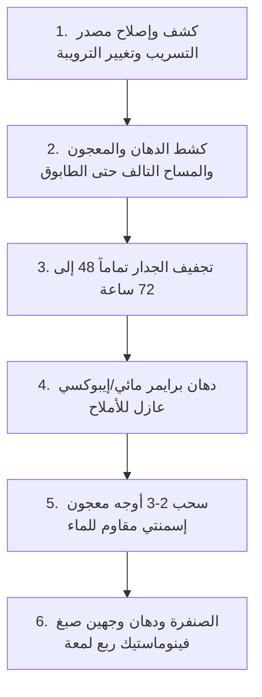

# تكلفة معالجة رطوبة الجدران وإعادة صبغها في الكويت: دليل تشخيص المشكلة والحل الجذري 2026

**تتراوح تكلفة معالجة طوفة رطبة وإعادة صبغها في الكويت بين 30 إلى 60 ديناراً كويتياً للجدار الواحد بمساحة متوسطة (3×3 إلى 4×3 متر)، وتشمل هذه التكلفة كشط طبقات المعجون والمساح التالف المتشبع بالماء، ومعالجة الحائط ببرايمر عازل ومضاد للأملاح، وسحب معجون إسمنتي مقاوم للمياه، والصبغ النهائي بوجهين دهان أصلي. أما إذا كانت الرطوبة ناتجة عن تسريب صحي داخلي في بايبات الصرف أو نش درين التكييف، فإن التكلفة الإجمالية قد تصل إلى 70 إلى 140 ديناراً كويتياً شاملة كشف التسريب وإصلاح المصدر التأسيسي أولاً.**

---

يعتبر مشهد انتفاخ صبغ الجدار (الطوفة)، وسقوط قشور المعجون كبودرة بيضاء على الأرض، وتكون بقع صفراء أو سوداء تشبه الخرائط العشوائية في غرف النوم أو الممرات، من أكثر المشاكل المزعجة والشائعة في البيوت والشقق والفلل الكويتية.

يلجأ الكثير من أصحاب المنازل إلى الحل الأسهل والأسرع ظاهرياً: الاتصال بأي صباغ متجول يطلب 15 ديناراً لكشط القشور ودهان وجه صبغ فوري لتجميل المكان قبل استقبال الضيوف. ولكن ما يحدث حتماً هو أن الرطوبة المحتبسة داخل الطابوق والمساح الإسمنتي تعاود الانفجار من جديد خلال 4 إلى 8 أسابيع، مسببة تآكل الحائط وانتشار روائح العفونة المزعجة التي تضر بأصحاب الحساسية والربو، مع ضياع كامل للأموال التي دُفعت في الصبغ السطحي.

إن القاعدة الهندسية الذهبية التي لا تقبل الجدال في الكويت تقول: **"الصبغ هو خطوة تشطيب جمالية أخيرة، ولا يمكن لأي دهان في العالم أن يعالج رطوبة طوفة ما لم يتم كشف وإيقاف مصدر تسريب المياه أولاً، وتجفيف الجدار تماماً، وإعادة التأسيس بمواد عزل كيميائية متخصصة."**

في هذا الدليل التفصيلي الشامل، نكشف لك التكلفة الواقعية لمعالجة رطوبة الجدران في الكويت بالأرقام، وكيف تشخص سبب الرطوبة بنفسك، والخطوات الهندسية المعتمدة التي تضمن لك حلاً جذرياً لا تعود بعده الرطوبة نهائياً.

---

## جدول تكلفة معالجة وعزل رطوبة الجدران في الكويت حسب مستوى الضرر لعام 2026

تختلف تكلفة علاج الجدار الرطب في الكويت بناءً على عمق التلف ومصدر الرطوبة، كما يوضح الجدول الاسترشادي التالي بالدينار الكويتي (KWD):

| حالة الرطوبة ونوع المشكلة في الجدار | مصدر الرطوبة الأساسي | مراحل العمل المطلوبة | التكلفة التقديرية للجدار الواحد (3×4 م) | مدة إنجاز العمل والجفاف |
|---|---|---|:---:|:---:|
| **1. رطوبة سطحية خفيفة مع عفن هوائي** | سوء تهوية وتكثف بخار (قرب نافذة أو حمام) | تنظيف الفطريات بمحلول معقم + كشط موضعي + برايمر عازل + وجهين صبغ مضاد للبكتيريا | **20 - 35 د.ك** | يوم إلى يومين |
| **2. نش درين التكييف السنترال أو الوحدات** | انسداد بايب تصريف المكيف وتسريب مياه خلف الجدار | تسليك/إصلاح بايب التكييف + كشط المعجون المنتفخ + تجفيف + معجون مقاوم + صبغ | **35 - 65 د.ك** | 2 - 3 أيام |
| **3. رطوبة عميقة وتملح (ملاصقة لحمام)** | تسريب ترويبة السيراميك أو كوع ماء مخفي بالحمام | كشف الخرير + صيانة ترويبة الحمام + كشط المساح حتى الطابوق + عازل إسمنتي بلوري + صبغ | **60 - 110 د.ك** | 3 - 5 أيام |
| **4. رطوبة صاعدة في الدور الأرضي أو السرداب** | مياه جوفية وغياب عازل الرطوبة التأسيسي (DPC) | تكسير المساح بارتفاع 50 سم + حقن مواد عازلة بلورية + مساح إسمنتي معالج + دهان تنفسي | **80 - 150 د.ك** | 5 - 7 أيام |

> **تنويه فني:** الأسعار تشمل المواد المتخصصة والمصنعية لجدار غرف المعيشة أو النوم القياسية. إذا كانت المشكلة ممتدة في سرداب كامل، ننصحك بالاطلاع على تفاصيل [علاج رطوبة السرداب وتملح الجدران في الكويت](/blog/basement-dampness-treatment-kuwait).

---

## التشخيص أولاً: 4 أسباب رئيسية لرطوبة الجدران في البيوت الكويتية

قبل أن تدفع ديناراً واحداً في شراء معجون أو صبغ، يجب أن تعرف من أين يأتي الماء بالضبط. في 95% من الحالات السكنية بالكويت، يعود السبب إلى أحد هذه المصادر الأربعة:

```
أسباب رطوبة الجدران في بيوت الكويت:
├── 1. نش درين التكييف السنترال (السبب رقم 1 في الصيف) -> بقع رطوبة صفراء أعلى الجدار أو حول مجاري الهواء
├── 2. تسريب فواصل وترويبة الحمامات -> تقشير أسفل الجدار الفاصل بين الحمام وغرفة النوم المجاورة
├── 3. الرطوبة الأرضية الصاعدة (Rising Damp) -> انتفاخ الدهان من نعلة الأرضية حتى ارتفاع متر في الدور الأرضي
└── 4. مياه الأمطار وتسريبات الشباك والواجهة -> ظهور الرطوبة في فصل الشتاء حول براويز الدرايش والزوايا الخارجية
```

### 1. نش درين التكييف السنترال (الخطر الصيفي الصامت)
بسبب عمل أجهزة التكييف السنترال والوحدات في الكويت على مدار 24 ساعة في أشهر الصيف الحارة (تحت درجات حرارة تتجاوز 50°م)، ينتج المكيف عشرات اللترات من الماء المتكثف يومياً. إذا انسد بايب الدرين بسبب الغبار والطحالب، يفيض الماء داخل تجويف الحائط الجبسي أو يتشربه الطابوق الإسمنتي ببطء، ليظهر فجأة على شكل انتفاخ دائري بالدهان واصفرار قبيح في أعلى الجدار.

### 2. تسريب وترويبة حمامات الضيوف والغرف
تعتبر الجدران المشتركة بين غرف النوم والحمامات هي الضحية الكلاسيكية للرطوبة في فلل الكويت. السبب في الغالب ليس كسراً في بايب رئيسي، بل تلف "الترويبة" الإسمنتية بين بلاطات السيراميك عند منطقة الشاور أو خلف المغسلة. يتسرب ماء الاستحمام اليومي قطرة قطرة خلف البلاط ويتحرك أفقياً عبر الطابوق ليخرج من جهة غرفة النوم، متسبباً في تفكك المعجون وتملح الطوفة.

### 3. الرطوبة الصاعدة والأملاح (Rising Damp)
تحدث في السراديب والطوابق الأرضية بالمناطق ذات المياه الجوفية المرتفعة أو التربة الرطبة (مثل السالمية، الفنطاس، جنوب السرة، والعدان). في غياب حاجز عازل قطعي (Damp-Proof Course) أثناء صب الأساسات، تصعد المياه الجوفية المحملة بأملاح الكبريتات عبر الخاصية الشعرية لمسام الخرسانة، وعندما يصل الماء إلى سطح الجدار ويتبخر بفعل التكييف، تتبلور الأملاح ميكانيكياً تحت طبقة الدهان وتفتتها كلياً.

### 4. شروخ واجهة السيجما وتسريب الأمطار
شروخ التمدد الدقيقة في واجهة السيجما الخارجية أو الفراغات المحيطة ببراويز الألمنيوم للنوافذ (الدرايش) تسمح لمياه أمطار الشتاء الرعدية والرياح القوية باختراق الجدار والوصول إلى الغرف الداخلية. وإذا كانت جدرانك تعاني من عيوب صبغ وتقشر بدون رطوبة نشطة، راجع مقالنا حول [أسباب انتفاخ دهان الطوفة وسقوط المعجون وطرق العلاج](/blog/paint-blistering-causes-kuwait).

---

## الخطوات الهندسية الخمس لعلاج الطوفة الرطبة وضمان عدم عودة الرطوبة

للحصول على نتيجة تدوم لسنوات ولا تتأثر بمناخ الكويت، يتبع الفنيون المحترفون هذا البروتوكول الهندسي الصارم:



### الخطوة الأولى: إيقاف وإصلاح المصدر التأسيسي أولاً
لا تبدأ بأي خطوة صباغة قبل التأكد 100% من معالجة سبب الماء: سواء بتسليك بايب درين التكييف، أو استبدال سيفون الحمام التالف، أو تجديد ترويبة السيراميك بـ "ترويبة إيبوكسية عازلة" (Epoxy Grout) مقاومة لتسرب الماء، أو حقن فواصل الشباك بالسليكون البوليمري.

### الخطوة الثانية: الكشط الميكانيكي العميق
يجب كشط كامل طبقات الدهان والمعجون المبلل، وتوسيع منطقة الكشط بمسافة 30 إلى 50 سم حول المنطقة المصابة بالرطوبة. إذا كان المساح الإسمنتي نفسه هشاً وتتفتت ذراته باليد، فيجب تكسيره حتى الوصول إلى الطابوق الأسود أو الخرسانة الصلبة؛ فالصبغ فوق مساح مفرغ وهش مضيعة مؤكدة للوقت والمال.

### الخطوة الثالثة: التجفيف الكامل والتهوية
يُمنع منعاً باتاً وضع المعجون فوق جدار مبلل. يجب ترك الطوفة مكشوفة لتجف في هواء الغرفة لمدة تتراوح بين **3 إلى 7 أيام**، ويمكن تسريع العملية في البيوت المأهولة باستخدام أجهزة سحب الرطوبة الكهربائية (Dehumidifiers) أو مجففات الهواء الساخن الميكانيكية.

### الخطوة الرابعة: المعالجة الكيميائية والعزل المائي (Bonding Primer)
يتم دهان الجدار بـ **برايمر عازل ومضاد للأملاح** (مثل البرايمر الإسمنتي البلوري أو البرايمر الزيتي عالي الالتصاق). هذه المادة تتغلغل داخل مسامات الطابوق بعمق عدة مليمترات وتشكل حاجزاً بلورياً يمنع أي رطوبة متبقية في عمق الحائط من الخروج إلى الطبقة الخارجية.

### الخطوة الخامسة: سحب معجون إسمنتي مقاوم للرطوبة والصبغ النهائي
* **نوع المعجون:** لا تستخدم المعجون الجيري الداخلي العادي الرخيص؛ فهو يمتص الرطوبة كالإسفنج وينهار. يجب استخدام **معجون إسمنتي أكريليكي مقاوم للماء (Cementitious Water-Resistant Putty)** من ماركات معتمدة مثل سافيتو أو كابارول.
* **الصبغ النهائي:** بعد صنفرة المعجون بدقة، يتم دهان وجه أساس ثم وجهين من دهان داخلي عالي الجودة مضاد للفطريات والبكتيريا وقابل للمسح، مثل **جوتن فينوماستيك ربع لمعة**. ولمعرفة تكلفة صبغ الغرفة بالكامل بعد المعالجة، يمكنك مراجعة [سعر صبغ الغرفة بالكويت للتشطيب النهائي](/blog/room-painting-cost-kuwait).

---

## 3 حيل تجارية احذر منها عند الاتفاق على "علاج الرطوبة"

يقع الكثير من المواطنين والمقيمين ضحية أساليب ترقيع مؤقتة يتبعها بعض الصباغين غير المتخصصين:

1. **حيلة "الصبغ الزيتي العازل المباشر":** يخبرك الصباغ: *"أنا سأدهن لك وجه صبغ زيتي قوي، وهو سيقفل المسام ولن تخرج الرطوبة أبداً!"*. هذه أكبر خدعة كيميائية؛ فالصبغ الزيتي يشكل طبقة نايلون غير منفذة، والماء المحتبس في الجدار سيغلي تحت هذه الطبقة بفعل حرارة البيت، ليتجمع على شكل فقاعات ماء كبيرة تنتفخ ثم تنفجر خلال أسبوعين كاشفة عن سواد وعفن مروع أسفلها.
2. **عدم كشط المساح المهترئ:** يكتفي العامل بصنفرة سطحية خفيفة وسحب وجه معجون عادي فوق الطوفة المبللة لتوفير التعب والوقت، مما يضمن عودة التقشير بمجرد استلام أجرته ومغادرة المكان.
3. **تجاهل ترويبة الحمام والاكتفاء بصبغ غرفة النوم:** إذا كان تسريب الحمام مستمراً، فلن ينجح أي عازل داخلي في العالم في إيقاف ضغط الماء الدائم. الحل الجذري يبدأ دائماً من "الجهة الرطبة" (داخل الحمام) وليس من غرفة النوم.

---

## مثال تطبيقي عملي: ميزانية معالجة جدار غرفة نوم ملاصق لحمام بالكويت

لكي تحسب تكلفة الصيانة الواقعية لبيتك، دعنا نأخذ هذه الحالة الشائعة جداً في قسائم صباح السالم أو إشبيلية أو الأندلس:

### المشكلة:
* جدار غرفة نوم بطول 4 أمتار ملاصق لحمام رئيسي، يعاني من تقشر الدهان وتملح بطول مترين في الأسفل بسبب ترويبة متهالكة في أرضية الشاور.

### تفصيل التكاليف والمواد المطلوبة:
1. **صيانة وتجديد ترويبة الحمام الملاصق:** تفريغ الترويبة القديمة وتطبيق ترويبة إيبوكسية ألمانية عازلة للماء = **15 إلى 20 د.ك**.
2. **كشط وتجهيز الجدار التالف بغرفة النوم:** كشط الصبغ والمعجون القديم بمساحة 4×2 متر = **10 إلى 15 د.ك**.
3. **مواد المعالجة المتخصصة:** جالون برايمر عازل مضاد للأملاح + شيكارة معجون إسمنتي مقاوم للرطوبة = **10 إلى 14 د.ك**.
4. **الصبغ والتشطيب النهائي:** وجهين دهان جوتن فينوماستيك ربع لمعة متطابق مع لون الغرفة = **8 إلى 12 د.ك**.
5. **أجور اليد العاملة والتشطيب والنظافة:** = **20 إلى 30 د.ك**.
* **التكلفة الإجمالية لمعالجة المشكلة جذرياً مع كفالة مكتوبة:** **63 إلى 91 دينار كويتي تقريباً**.

بهذا الحل المتكامل، تضمن علاج تسريب الحمام، وعزل الجدار، وتشطيبه بأصباغ أصلية دون أن تعود المشكلة لتشوه بيتك مرة أخرى.

---

## أسئلة شائعة حول معالجة رطوبة الجدران في الكويت

### كم يوماً يحتاج الجدار الرطب ليجف قبل الصبغ؟
يحتاج الجدار بعد كشطه إلى مدة تتراوح بين **3 إلى 7 أيام** في البيوت المكيفة لضمان جفاف عمق البلوك الإسمنتي تماماً. دهان المعجون فوق طوفة لم تجف 100% هو السبب رقم واحد لفشل أعمال معالجة الرطوبة.

### هل يمكن استخدام عازل "جيتاروف" لعلاج الرطوبة داخل الغرف؟
لا، عازل جيتاروف (Gitaroof) هو عازل مطاطي مخصص للأسطح الخارجية المكشوفة، ولا يصلح استخدامه داخل غرف النوم أو الصالات تحت المعجون والصبغ الداخلي؛ لأن سماكته المطاطية لا تسمح بالتصاق معجون الحوائط العادي وتتسبب في انسلاخ طبقات الدهان. العوازل المعتمدة للجدران الداخلية هي البرايمرات الإسمنتية البلورية أو البرايمرات الرابطة المتخصصة.

### هل الترويبة الإيبوكسية للحمام تحل مشكلة رطوبة غرفة النوم نهائياً؟
نعم، إذا كان مصدر التسريب هو تخلخل مياه الاستحمام بين فواصل السيراميك، فإن تفريغ الفواصل وتطبيق ترويبة إيبوكسية عالية الصلابة يعزل أرضية الحمام تماماً ويمنع تسرب أي قطرة ماء إضافية إلى الجدار المشترك.

---

## الحل الجذري لبيتك: فحص هندسي دقيق وضمان معتمد

التخلص من رطوبة الجدران وتملح الطوفة ليس أمراً مستحيلاً، ولكنه يتطلب فنيين يمتلكون عقلية التشخيص الهندسي وليس مجرد عمالة تدهن فوق العيوب.
* تعرف على المزيد من الحلول المتخصصة عبر [خدمات معالجة الرطوبة والنش المائي بالجدران في الكويت](/services-guide).
* وإذا كنت تعاني من جدار رطب في منزلك وتريد كشفاً دقيقاً على مصدر التسريب وتحديد التكلفة الحقيقية بدون مبالغات، يمكنك الآن [طلب فحص ومعاينة رطوبة الجدران عبر منصة صباغ الكويت](/request-quote) للحصول على كشف فني متخصص وحل جذري مع ضمان مكتوب.
